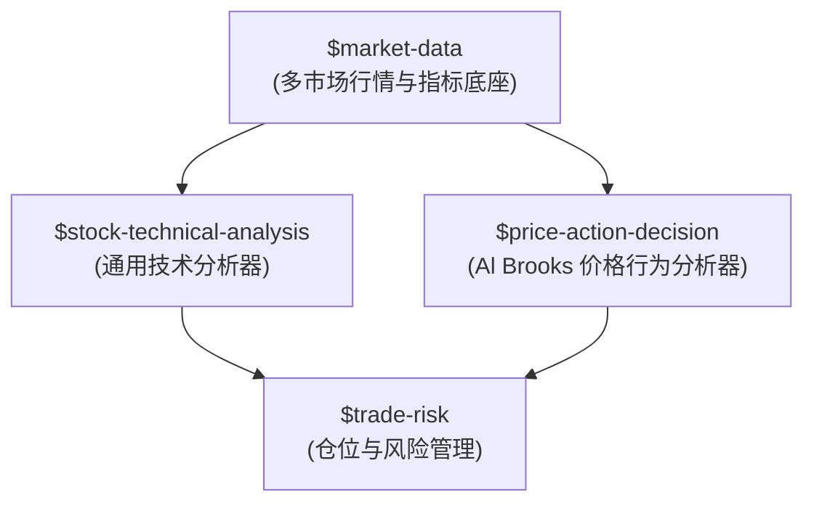

# Trading Skills Suite (交易分析与决策技能套件)

这是一个专为 AI Agent（Claude Code、Codex、Gemini、Antigravity 等）打造的专业交易技术分析与价格行为技能套件。

本仓库采用多技能 Monorepo 统一组织，将交易流程清晰解耦为“**行情底座 $\rightarrow$ 平级分析器 $\rightarrow$ 仓位风控**”的专业化架构。

---

## 技能组成与职责划分



| 技能 (Skill) | 目录位置 | 核心定位与职责 |
|---|---|---|
| **market-data** | `skills/market-data/` | **行情事实与指标预计算**：支持 A股/ETF、港股、美股、加密货币。无缓存直接并发取数、完整 K 线剥离，预计算 EMA20/MA/VMA20/RSI14/MACD 及 Swing 极值。 |
| **stock-technical-analysis** | `skills/stock-technical-analysis/` | **通用技术分析与条件式计划**：标准市场结构（BOS/CHoCH）、支撑阻力、形态识别、量价背离与多周期通用 Playbook。 |
| **price-action-decision** | `skills/price-action-decision/` | **Al Brooks 价格行为决策器**：严格遵循 Al Brooks 原生体系（事实优先 $\rightarrow$ 市场周期 $\rightarrow$ Always In $\rightarrow$ 多空意图 $\rightarrow$ 最佳动作）。平级独立分析器。 |
| **trade-risk** | `skills/trade-risk/` | **风控与仓位计算**：根据已确认的逻辑止损和账户约束，科学计算仓位规模，管理单笔与组合风险。 |

---

## 目录结构

```text
.
├── skills/
│   ├── market-data/               # 行情数据获取、清洗与指标预计算基座
│   │   ├── SKILL.md
│   │   ├── scripts/               # 多源取数与计算脚本
│   │   ├── references/            # 接口与周期规范
│   │   └── tests/
│   ├── stock-technical-analysis/  # 通用技术分析工作流与知识库
│   │   ├── SKILL.md
│   │   ├── workflows/             # 分析与复盘工作流
│   │   ├── references/            # 核心概念、指标、形态与 Playbook
│   │   ├── strategies/            # 策略配置
│   │   └── tests/
│   ├── price-action-decision/     # Al Brooks 价格行为分析与决策
│   │   ├── SKILL.md
│   │   ├── scripts/               # 盘中切片与快照生成
│   │   ├── references/            # Brooks 知识体系与战法
│   │   └── tests/
│   └── trade-risk/                # 交易风险与仓位控制
│       ├── SKILL.md
│       └── references/
├── docs/                          # 架构与多维决策规范
├── tests/                         # 套件集成测试入口
├── CLAUDE.md                      # AI 协作指引
└── README.md
```

---

## 本地安装与挂载方式

各 AI 平台通过软链接接入本套件，修改本仓库即可实时生效：

```bash
# 挂载到 ~/.agents/skills/
ln -snf "$(pwd)/skills/market-data" ~/.agents/skills/market-data
ln -snf "$(pwd)/skills/stock-technical-analysis" ~/.agents/skills/stock-technical-analysis
ln -snf "$(pwd)/skills/price-action-decision" ~/.agents/skills/price-action-decision
ln -snf "$(pwd)/skills/trade-risk" ~/.agents/skills/trade-risk

# Codex / Gemini 亦可直接链接或引用 ~/.agents/skills
```

---

## 运行测试

套件包含完整的契约与规则回归测试：

```bash
python3 tests/run_all_tests.py
```

---

## 免责声明

本套件所有 Skill 仅供研究与学习使用，不构成任何投资建议。实际交易存在高度风险，盈亏自负。
